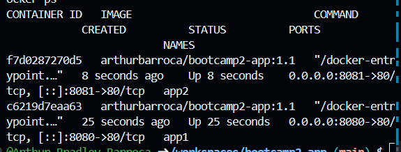

# Arquivo Sombrio

## Autor
Arthur Bradley Barroca — Matrícula 22603901

## Descrição
Um catálogo de séries e filmes de terror, suspense e slasher: o usuário
digita o nome de um título (ou escolhe um dos "casos sugeridos") e a
aplicação monta um dossiê visual com pôster, gêneros, avaliação, ano de
estrela, status e sinopse de cada resultado encontrado.

## API utilizada
- Nome da API e link da documentação: [TVmaze API](https://www.tvmaze.com/api)
- Endpoint(s) consumido(s): `GET https://api.tvmaze.com/search/shows?q=:termo`

## Funcionalidades
- Buscar um filme/série pelo nome digitado em um campo de texto
- Clicar em um dos "casos sugeridos" (chips) para preencher a busca e consultar na hora
- Ver, para cada resultado: pôster, gêneros, ano de estreia, status, avaliação e sinopse
- Receber um selo de "Caso confirmado" quando o título já pertence a um gênero de terror/suspense/mistério
- Ver mensagens amigáveis quando a busca não encontra nada ou quando a API está fora do ar
- **Favoritos com persistência em banco real (Supabase)** — dados sobrevivem ao fechar o navegador

## Persistência de Dados (Etapa 02)
### Banco escolhido
**Supabase** (PostgreSQL) — plano gratuito, região South America para menor latência.

### Estrutura da tabela
```sql
CREATE TABLE favoritos (
  id BIGSERIAL PRIMARY KEY,
  criado_em TIMESTAMPTZ DEFAULT NOW(),
  nome_show TEXT NOT NULL,
  generos TEXT,
  imagem_url TEXT,
  avaliacao NUMERIC(3,1),
  status TEXT,
  regiaodeestreia TEXT
);
```

### O que é salvo
Quando o usuário clica em "Guardar no arquivo", os seguintes dados são persistidos no Supabase:
- Nome do show (`nome_show`)
- Gêneros (`generos`)
- URL da imagem (`imagem_url`)
- Avaliação (`avaliacao`)
- Status (`status`)
- Ano de estreia (`regiaodeestreia`)

### Políticas RLS
Nesta etapa, políticas abertas para anon são configuradas para permitir leitura e escrita. **Limitação conhecida:** qualquer pessoa com a chave anon poderia acessar os dados; em produção, deveria haver autenticação de usuário.

### Como usar
1. Crie uma conta em [supabase.com](https://supabase.com)
2. Crie um novo projeto (região South America)
3. No Table Editor, crie a tabela `favoritos` com as colunas acima
4. Em Project Settings → API, copie a URL e a chave anon
5. Substitua `SUPABASE_URL` e `SUPABASE_KEY` no script.js

## Como executar localmente
1. Clone: `git clone https://github.com/Arthur-Bradley-Barroca/bootcamp2-app.git`
2. Abra o arquivo `index.html` no navegador

## Como executar com Docker
```bash
docker run -d -p 8080:80 arthurbb/bootcamp2-app:1.0
```
Acesse http://localhost:8080

## Docker Hub
- **Imagem:** `arthurbb/bootcamp2-app`
- **Tags disponíveis:** `1.0`, `1.1`, `latest`
- **Repositório:** https://hub.docker.com/r/arthurbb/bootcamp2-app

## Arquivos de conteinerização
### Dockerfile
```dockerfile
FROM nginx:alpine
COPY index.html style.css script.js /usr/share/nginx/html/
EXPOSE 80
```

### .dockerignore
```
.git
README.md
nul
```

## Sidequests completados

### SQ1 · .dockerignore
Arquivo `.dockerignore` criado excluindo `.git`, `README.md` e `nul`. Isso deixa a imagem menor e o build mais rápido.

### SQ2 · Versionamento de imagem
Três tags publicadas no Docker Hub:
- `1.0` — primeira versão funcional com persistência Supabase
- `1.1` — versão com melhorias de UI
- `latest` — aponta para a versão mais recente

### SQ3 · Descrição no Docker Hub
O repositório no Docker Hub contém descrição completa, comando docker run pronto para copiar e link do repositório GitHub.

### SQ4 · Orquestração
Dois containers foram executados simultaneamente em portas 8080 e 8081. Print do `docker ps` está commitado no repositório.

**Sobre Kubernetes:** Se houvesse 100 containers, usaria Kubernetes para gerenciá-los. O Kubernetes automatiza deploy, escalabilidade e gerenciamento de containers. Conceitos-chave:
- **Cluster:** conjunto de máquinas (nodes) que rodam workloads
- **Pod:** unidade mínima de deploy
- **Replica:** cópia de um pod; o Kubernetes mantém o número desejado rodando
- **Deployment:** gerencia pods e réplicas, permite rollback e atualizações
- Com 100 containers, usaria Deployments com réplicas, Services para expor, e Horizontal Pod Autoscaler para escalar com demanda.

## Links
- **Aplicação no ar (GitHub Pages):** https://arthur-bradley-barroca.github.io/bootcamp2-app/
- **Repositório:** https://github.com/Arthur-Bradley-Barroca/bootcamp2-app
- **Docker Hub:** https://hub.docker.com/r/arthurbb/bootcamp2-app

## Etapa 02 — Persistência + Docker

### Links do projeto

- **Repositório no GitHub:** https://github.com/Arthur-Bradley-Barroca/bootcamp2-app
- **Aplicação no GitHub Pages:** https://arthur-bradley-barroca.github.io/bootcamp2-app/
- **Repositório no Docker Hub:** https://hub.docker.com/r/arthurbarroca/bootcamp2-app

### Como rodar com Docker

Com o Docker instalado, basta uma linha:

```bash
docker run -d -p 8080:80 arthurbarroca/bootcamp2-app:1.1
```

Depois, abra http://localhost:8080 no navegador.

---

## Persistência de dados

**Banco escolhido:** Supabase (PostgreSQL), plano gratuito, região South America. O frontend conversa direto com o banco pela biblioteca `supabase-js`, sem servidor próprio.

**O que é salvo:** o "arquivo pessoal" do usuário. Ao clicar em **"Guardar no arquivo"** em um resultado da busca, o título (série ou filme) é gravado no banco. A seção **"O meu arquivo"** lista os títulos guardados assim que a página abre, e cada item tem um botão **"Remover do arquivo"**. Os dados sobrevivem ao fechar o navegador, porque ficam no banco e não no navegador (não uso `localStorage`).

**Operações implementadas:**

| Operação | Como funciona |
|---|---|
| Create | `insert` na tabela `favoritos` ao clicar em "Guardar no arquivo" |
| Read | `select` ordenado por `criado_em` (mais recentes primeiro), ao abrir a página e após cada mudança |
| Delete | `delete` filtrando pelo `id`, ao clicar em "Remover do arquivo" |

**Estrutura da tabela `favoritos`:**

| Coluna | Tipo | Descrição |
|---|---|---|
| `id` | bigint | Identificador único do registro |
| `criado_em` | timestamptz | Data e hora em que foi guardado (padrão: `now()`) |
| `nome_show` | text | Nome da série ou filme |
| `generos` | text | Gêneros, separados por vírgula |
| `imagem_url` | text | Endereço da capa |
| `avaliacao` | numeric | Nota média da TVmaze |
| `status` | text | Situação (Running, Ended etc.) |
| `regiaodeestreia` | text | Ano de estreia |

**Limitação conhecida:** nesta etapa, as políticas de segurança (RLS) da tabela estão abertas para o papel `anon`, permitindo leitura, inserção e exclusão por qualquer visitante. Isso é aceitável para o escopo do desafio, mas em um produto real cada usuário teria login e políticas restritas aos próprios registros. A chave usada no frontend é a chave pública (publishable/anon), feita para esse uso.

---

## Docker

### Dockerfile

```dockerfile
FROM nginx:alpine
COPY index.html style.css script.js /usr/share/nginx/html/
EXPOSE 80
```

A aplicação é servida por um Nginx dentro do container. O Supabase continua funcionando de dentro do container, porque o site chama o banco diretamente pela internet.

---

## Sidequests

### SQ1 — `.dockerignore`

Conteúdo do arquivo:

```
.git
.gitignore
README.md
*.png
```

**Por que isso deixa a imagem menor e o build mais rápido:** antes de construir a imagem, o Docker envia ao seu motor (daemon) todo o conteúdo da pasta do projeto, chamado de *contexto de build*. O `.dockerignore` remove dessa lista itens que a aplicação não precisa para rodar, como o histórico do Git (`.git`, que costuma ser a parte mais pesada), o README e as capturas de tela. Com um contexto menor, o envio e o build são mais rápidos, e arquivos desnecessários ou sensíveis não entram na imagem por acidente caso o Dockerfile passe a copiar a pasta inteira (`COPY . .`). Neste projeto o `COPY` já lista só três arquivos, então o ganho principal é a velocidade do build e a segurança contra esse tipo de inclusão acidental.

### SQ2 — Versionamento de imagem

Três tags publicadas no Docker Hub:

| Tag | Descrição |
|---|---|
| `1.0` | Primeira versão funcional, com persistência no Supabase |
| `1.1` | Versão com o rodapé atualizado |
| `latest` | Aponta para a versão mais recente (igual à 1.1) |

```bash
docker pull arthurbarroca/bootcamp2-app:1.0
docker pull arthurbarroca/bootcamp2-app:1.1
docker pull arthurbarroca/bootcamp2-app:latest
```

### SQ3 — Descrição no Docker Hub

O overview do repositório em https://hub.docker.com/r/arthurbarroca/bootcamp2-app contém: o que é a aplicação, o comando `docker run` pronto para copiar e o link do repositório no GitHub.

### SQ4 — Explorando a orquestração

Dois containers da mesma imagem rodando ao mesmo tempo, nas portas 8080 e 8081:

```bash
docker run -d -p 8080:80 --name app1 arthurbarroca/bootcamp2-app:1.1
docker run -d -p 8081:80 --name app2 arthurbarroca/bootcamp2-app:1.1
docker ps
```

**Evidência:**



**Se eu tivesse 100 containers, como gerenciaria?**

Subir e vigiar 100 containers à mão, um `docker run` por vez, seria inviável: eu teria que escolher em qual máquina cada um roda, reiniciar os que caíssem e atualizar um por um. É para isso que existe o **Kubernetes**, um orquestrador de containers. Seus conceitos centrais são o **cluster**, o conjunto de máquinas (nós) que o Kubernetes gerencia como se fosse um só computador; o **pod**, a menor unidade que ele executa, que normalmente envolve um container da aplicação; e a **réplica**, cada cópia idêntica de um pod. Eu declaro o estado que quero, por exemplo "quero 100 réplicas da minha aplicação", e o Kubernetes distribui os pods entre as máquinas do cluster, recria automaticamente os que falharem, balanceia o tráfego entre as réplicas e permite atualizar a versão aos poucos, sem derrubar o serviço. Os meus dois containers nas portas 8080 e 8081 são, em miniatura, duas réplicas da mesma aplicação, só que gerenciadas por mim manualmente.
